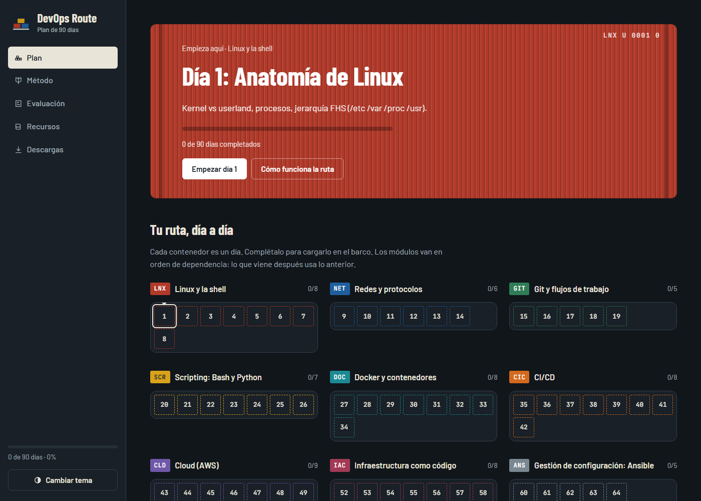
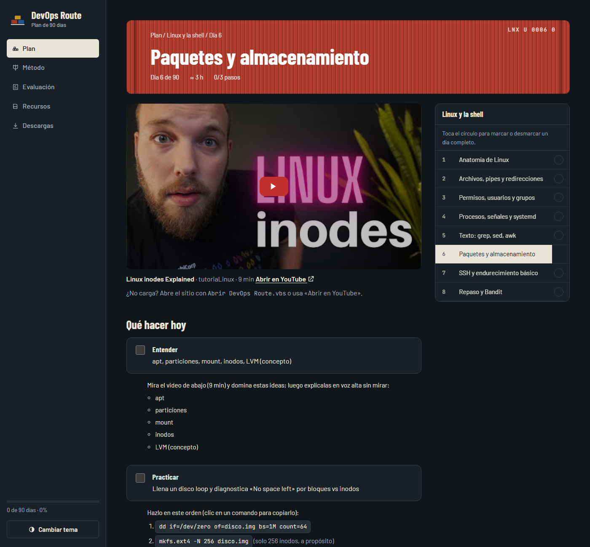
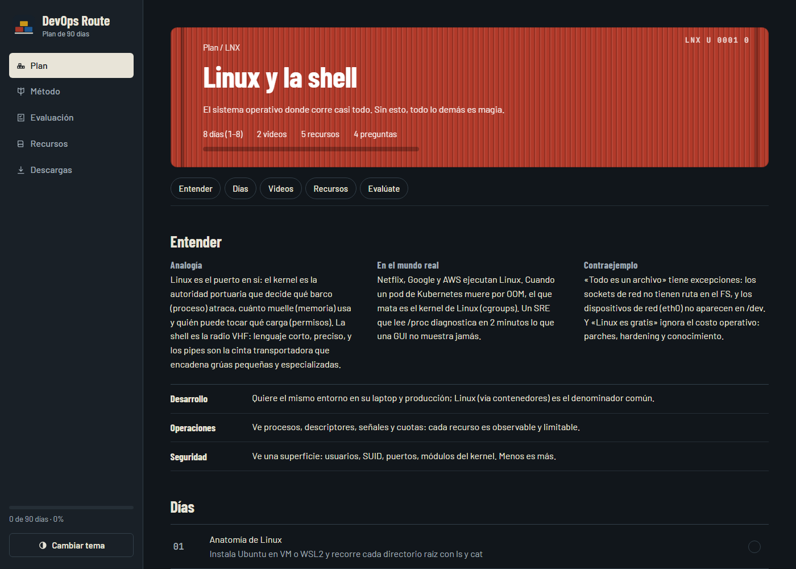
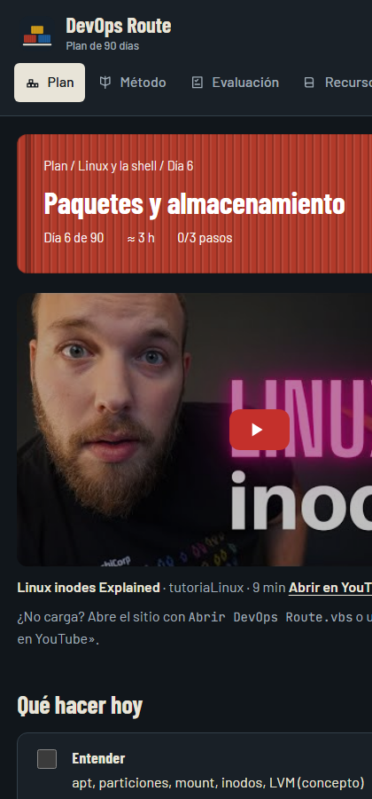

# DevOps Route

Plan de estudio DevOps de **90 días**, en español, con formato de plataforma de cursos: un día = un video corto + práctica con comandos + una prueba de 3 preguntas. Todo con recursos **gratuitos** (YouTube, documentación oficial, capa gratuita de AWS).

Es un sitio estático (HTML + CSS + JS, sin frameworks ni dependencias). Tu progreso se guarda en tu propio navegador.



## Qué incluye

| | |
|---|---|
| **12 módulos** | Linux, redes, Git, scripting, Docker, CI/CD, cloud (AWS), IaC, Ansible, Kubernetes, observabilidad y seguridad |
| **90 lecciones** | Cada una con un video corto específico del tema, ideas a dominar, comandos exactos copiables con un clic y un criterio de «listo cuando» |
| **90 pruebas diarias** | 3 preguntas por día con explicación de cada respuesta; si fallas puedes repetir con otras preguntas |
| **Quiz por módulo** | 4 preguntas por módulo, con indicación de qué módulo reforzar |
| **Examen integrador** | 24 preguntas de todo el plan |
| **Recursos y descargas** | Hojas de referencia (.md) por módulo, plan completo y tu progreso exportable |
| **Tema claro/oscuro** | Automático según tu sistema, con botón para cambiarlo |

### Una lección

Cada día tiene el video incrustado, el temario del módulo a la derecha (los círculos marcan el día completo) y la guía paso a paso:



### Un módulo

Cada módulo trae una analogía, un caso real, un contraejemplo, perspectivas y su lista de días:



### En el móvil



## Cómo usarlo

### Windows (recomendado)

1. Clona o descarga el repositorio.
2. Doble clic en **`Abrir DevOps Route.vbs`**.

Esto levanta un servidor local mínimo (PowerShell, sin instalar nada) y abre `http://localhost:8137/`. Se apaga solo cuando cierras la pestaña.

> **¿Por qué un servidor?** YouTube no reproduce videos incrustados en páginas abiertas con `file://` (error 153). Con `localhost` sí funcionan.

### Otros sistemas

Cualquier servidor estático sirve. Por ejemplo:

```bash
python3 -m http.server 8137
# luego abre http://localhost:8137/
```

## Cómo se estudia

1. Entra al día y mira el video (4–26 min).
2. Haz los pasos de **Practicar** en tu terminal; haz clic en un comando para copiarlo.
3. Comprueba el criterio **Listo cuando**.
4. Marca los 3 pasos (o toca el círculo del temario) y responde la **prueba del día**.

La prueba no condiciona el avance: sirve para detectar lo que no quedó claro.

## Tu progreso

- Se guarda en `localStorage`, **por navegador y por dirección** (`file://` y `localhost:8137` guardan por separado).
- Para respaldarlo o moverlo: **Descargas → Exportar progreso (.json)** e **Importar** en el otro equipo.

## Estructura

```
index.html      Estructura de la página y guías de los 90 días
data.js         Módulos, días, videos, recursos y hojas de referencia
quizzes.js      90 pruebas diarias de 3 preguntas
app.js          Router, progreso, quizzes y reproductor
styles.css      Diseño (tema claro/oscuro)
favicon.svg     Icono
server.ps1      Servidor local sin dependencias (PowerShell)
Abrir DevOps Route.vbs   Lanzador transparente para Windows
docs/           Capturas de este README
```

## Aviso

- Los comandos de las guías están escritos de conocimiento y **no se ejecutaron uno por uno**. Si alguno falla o es ambiguo, abre un issue con el día y el paso.
- Los laboratorios de los días 43–51 usan recursos de AWS que **pueden generar costos**; cada guía indica cuándo eliminarlos. Revisa tu presupuesto.
- Los videos pertenecen a sus autores y se incrustan desde YouTube; algunos pueden desaparecer o cambiar con el tiempo.
- Las preguntas y guías fueron redactadas para este plan, no provienen de un banco de preguntas oficial.
